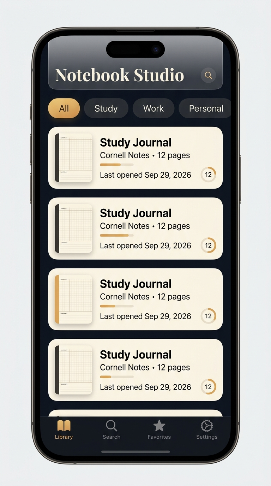
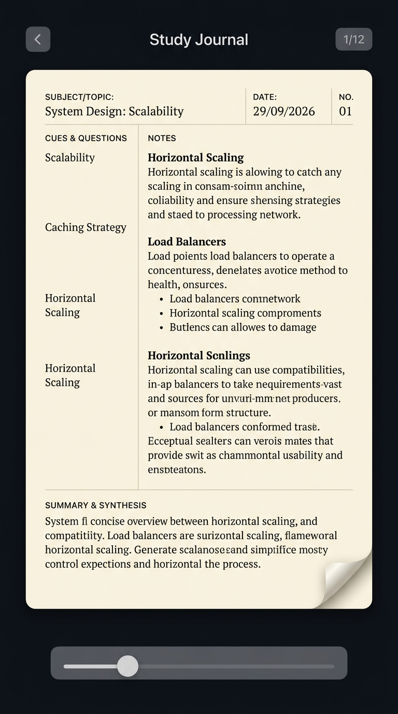
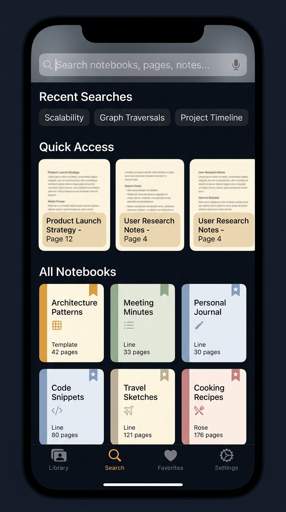

# 📱 Notebook Studio iOS — Concept Thiết Kế App Đọc

> **Triết lý**: App iOS tập trung vào **trải nghiệm đọc lại** các notebook đã viết trên web — biến điện thoại thành cuốn sổ bỏ túi mở ra đọc bất cứ lúc nào, không phải công cụ soạn thảo.

---

## 🎨 Visual Concept Mockups

### Library View


### Reader View


### Search & Discovery View


---

## 🧭 Kiến Trúc Màn Hình (4 Tab chính)

```
Tab Bar
├── 📚 Library
│   └── Notebook List → 📖 Reader View → Page Navigator
├── 🔍 Search
│   └── Full-text Search → Search Results → Reader
├── ⭐ Favorites
│   ├── Pinned Notebooks
│   └── Bookmarked Pages
└── ⚙️ Settings
    ├── Account & Sync
    ├── Reading Preferences
    └── Appearance
```

---

## 📚 Tab 1: Library (Thư viện)

### Thiết kế
- **Header lớn kiểu iOS** với title "Notebook Studio" bằng font serif thanh lịch
- **Category chips** cuộn ngang: All / Study / Work / Personal (filter theo category của notebook)
- **Sort options**: Mới mở gần nhất / Tên A-Z / Ngày tạo

### Card Notebook
Mỗi notebook hiển thị dạng **card ngang** với:

| Thành phần | Mô tả |
|:---|:---|
| **Thumbnail** | Preview thu nhỏ trang đầu tiên, nền giấy kem |
| **Title** | Tên notebook, font đậm |
| **Subtitle** | Template type + số trang (VD: "Cornell Notes • 12 pages") |
| **Last opened** | Thời gian mở lần cuối, relative ("2 giờ trước") |
| **Progress ring** | Vòng tròn nhỏ cho biết đã đọc đến trang mấy / tổng trang |
| **Quick actions** | Long-press → Pin / Share PDF / Mark as Read |

### Interaction
- **Tap** → Mở ngay trang đọc dở gần nhất (nhớ vị trí `lastOpenPage`)
- **Swipe left** → Quick actions: Pin / PDF / Delete
- **Pull to refresh** → Sync với server

---

## 📖 Tab Reader View (Màn hình đọc — Core Experience)

> ⚠️ Đây là màn hình quan trọng nhất, chiếm 90% thời gian sử dụng app.

### Triết lý đọc trên mobile
Khác web (2-page spread), mobile cần **1 trang full-screen** tối ưu cho đọc dọc:

### Layout cho từng template

**Cornell Notes** (tối ưu cho mobile):
```
┌─────────────────────────────┐
│ SUBJECT: System Design...   │
│ DATE: 29/09/2026    NO. 01  │
├────────┬────────────────────┤
│ CUES   │                    │
│        │  NOTES             │
│ Key-   │  Nội dung chính    │
│ words  │  được render       │
│        │  rõ ràng, font     │
│        │  lớn, dễ đọc       │
├────────┴────────────────────┤
│ SUMMARY & SYNTHESIS         │
│ Tóm tắt nội dung trang     │
└─────────────────────────────┘
```

**Work Notes** (render native):
```
┌─────────────────────────────┐
│ 🎯 Project Goal             │
│ ⏰ Deadline                  │
│ ┌─────────┬─────────┐      │
│ │  Notes  │ Actions │      │
│ │  ...    │ ☑ Task1 │      │
│ │  ...    │ ☐ Task2 │      │
│ └─────────┴─────────┘      │
│ Status: 🟡 WIP              │
└─────────────────────────────┘
```

**Ruled / Classic** (scrollable text):
```
┌─────────────────────────────┐
│ ─────────────────────────── │
│ Nội dung ghi chép tự do    │
│ ─────────────────────────── │
│ với các dòng kẻ tinh tế    │
│ ─────────────────────────── │
│ hỗ trợ scroll mượt mà      │
│ ─────────────────────────── │
└─────────────────────────────┘
```

### Navigation giữa các trang

| Gesture | Hành động |
|:---|:---|
| **Swipe trái/phải** | Lật trang tiến/lùi với animation nhẹ |
| **Tap cạnh phải** | Trang tiếp |
| **Tap cạnh trái** | Trang trước |
| **Page scrubber** | Thanh trượt ở đáy, kéo để nhảy nhanh đến trang bất kỳ |
| **Tap giữa màn hình** | Toggle hiện/ẩn UI chrome (immersive mode) |
| **Pinch zoom** | Phóng to/thu nhỏ nội dung trang |

### Reading Chrome (UI điều khiển)
- **Top bar** (auto-hide): ← Back | Tên sổ | Trang 3/12
- **Bottom scrubber** (auto-hide): Thanh trượt trang + mini page numbers
- **Floating menu** (tap giữa): Bookmark trang / Table of Contents / Reading settings

### Chế độ đọc đặc biệt

| Mode | Mô tả |
|:---|:---|
| **Night Mode** | Giấy tối (#1a1a1a), chữ kem nhạt, giảm độ sáng |
| **Sepia Mode** | Giấy kem ấm (#faf5e8) giống sổ thật |
| **Auto-brightness** | Tự điều chỉnh theo ánh sáng môi trường |
| **Focus Mode** | Chỉ hiện section đang đọc, mờ phần còn lại |

---

## 🔍 Tab 2: Search & Discovery

### Tìm kiếm toàn văn
- Search bar luôn sẵn sàng ở đầu tab
- **Tìm trong**: Tên sổ, nội dung trang, action items, summary
- **Kết quả hiển thị**: Snippet text với keyword được highlight vàng
- Tap kết quả → nhảy thẳng vào trang chứa từ khóa

### Quick Access
- **Hàng cuộn ngang** hiển thị 5 trang đọc gần nhất dạng card preview nhỏ
- Mỗi card có preview thu nhỏ nội dung trang + tên sổ + số trang

### Recent Searches
- Lưu lại 10 từ khóa tìm kiếm gần nhất dạng chips

---

## ⭐ Tab 3: Favorites

### Bookmarks & Pins
- **Sổ đã ghim** (pinned notebooks) — từ dữ liệu `pinned` có sẵn
- **Trang đã đánh dấu** (bookmarked pages) — tính năng mới cho mobile
- Hiển thị preview card với context snippet

---

## ⚙️ Tab 4: Settings

| Section | Nội dung |
|:---|:---|
| **Account** | Thông tin user, đổi mật khẩu, đăng xuất |
| **Sync** | Trạng thái đồng bộ, sync thủ công, last synced time |
| **Reading** | Font mặc định, cỡ chữ, khoảng cách dòng |
| **Appearance** | Light/Dark/Auto, Paper tone (Kem/Trắng/Dark) |
| **Offline** | Quản lý sổ đã cache offline |
| **About** | Version, licenses |

---

## 🎨 Design System

### Color Palette

| Token | Light | Dark | Dùng cho |
|:---|:---|:---|:---|
| `background` | `#f5f0eb` | `#0d1117` | Nền app |
| `surface` | `#ffffff` | `#161b22` | Card, sheet |
| `paper-cream` | `#faf5e8` | `#2a2520` | Nền trang giấy |
| `paper-white` | `#ffffff` | `#1e1e1e` | Giấy trắng |
| `accent` | `#c9a84c` | `#d4a849` | CTA, tab active |
| `text-primary` | `#1a1a1a` | `#e6e1d8` | Chữ chính |
| `text-secondary` | `#6b6b6b` | `#8b8b8b` | Chữ phụ |
| `border` | `#e0d8cc` | `#30363d` | Viền, đường kẻ |

### Typography

| Level | Font | Size | Weight |
|:---|:---|:---|:---|
| App Title | New York (serif) | 34pt | Bold |
| Section Header | SF Pro Display | 22pt | Semibold |
| Notebook Title | SF Pro Text | 17pt | Semibold |
| Body Text | SF Pro Text | 16pt | Regular |
| Page Content | Plus Jakarta Sans | 15-17pt | Regular |
| Caption | SF Pro Text | 13pt | Regular |
| Badge | SF Pro Text | 11pt | Medium |

### Micro-animations
- **Page turn**: Slide + fade 0.3s ease-out khi swipe
- **Card press**: Scale 0.97 + shadow reduce khi nhấn
- **Tab switch**: Cross-fade 0.2s
- **Pull to sync**: Lottie animation sổ tay mở ra
- **Search highlight**: Pulse glow vàng nhẹ trên keyword

---

## 🔄 Data & Sync Architecture

### Luồng dữ liệu
```
iOS App ──► Local Cache ──► Dữ liệu offline (đọc ngay)
   │                              ▲
   └──► Backend API ──────────────┘
         GET /api/notebooks        (background sync)
         PUT /api/notebooks/sync   (reading progress)
```

### Chiến lược Offline
- **Cache toàn bộ library metadata** khi mở app
- **Lazy-load nội dung trang** — chỉ tải khi user mở notebook
- **Cache LRU** cho 10 sổ đọc gần nhất → đọc offline không cần mạng
- **Background sync** khi có kết nối trở lại

### API endpoints sử dụng
Tận dụng API hiện có, **không cần thay đổi backend**:

| Endpoint | Mục đích trên iOS |
|:---|:---|
| `POST /api/login` | Đăng nhập, lưu JWT |
| `GET /api/notebooks` | Tải toàn bộ thư viện |
| `GET /api/notebooks/sync-meta` | Kiểm tra có cập nhật mới |
| `PUT /api/notebooks/sync` | Đồng bộ reading progress |

---

## 📱 Tính Năng Riêng Cho Mobile (Không Có Trên Web)

| Tính năng | Mô tả |
|:---|:---|
| **Bookmark trang** | Đánh dấu trang hay, tập trung vào tab Favorites |
| **Reading Progress** | Tracking % đã đọc mỗi sổ |
| **Haptic Feedback** | Rung nhẹ khi lật trang, bookmark |
| **Widget iOS** | Widget hiển thị sổ đang đọc dở trên Home Screen |
| **Spotlight Search** | Tìm notebook từ iOS Spotlight |
| **Quick Note (nhẹ)** | Chỉ thêm note ngắn vào trang, không phải editor đầy đủ |
| **Share Sheet** | Chia sẻ trang dạng ảnh/PDF qua Messages, Mail... |
| **Dynamic Type** | Hỗ trợ cỡ chữ hệ thống iOS cho accessibility |
| **Face ID** | Khóa app bằng sinh trắc học |

---

## 🛠 Công Nghệ Đề Xuất

| Lựa chọn | Lý do |
|:---|:---|
| **SwiftUI** | Native iOS, performance tốt nhất cho reading UX |
| **Swift Data / Core Data** | Offline cache và persistence |
| **URLSession** | Networking với JWT auth |
| **Combine** | Reactive sync state |
| **Lottie** | Micro-animations premium |

> 💡 Vì backend API đã sẵn sàng (Express + JWT), app iOS chỉ cần tập trung vào **render nội dung đẹp + UX đọc mượt**, không cần build lại logic phức tạp.

---

## 🚀 Roadmap Đề Xuất

### Phase 1 — MVP Reader (4-6 tuần)
- [ ] Login/Auth với JWT
- [ ] Library view + sync notebooks
- [ ] Reader view cho 3 template (Cornell, Work, Ruled)
- [ ] Page navigation (swipe + scrubber)
- [ ] Offline cache cơ bản
- [ ] Dark/Light mode

### Phase 2 — Polish & Features (3-4 tuần)
- [ ] Full-text search
- [ ] Bookmark pages + Favorites tab
- [ ] Reading progress tracking
- [ ] Paper tone settings (Kem/Trắng/Dark)
- [ ] Haptic feedback
- [ ] Share page as image

### Phase 3 — Advanced (2-3 tuần)
- [ ] iOS Widget
- [ ] Spotlight integration
- [ ] Face ID lock
- [ ] Quick note (thêm ghi chú ngắn)
- [ ] Background sync optimization

---

> 📝 Concept này giữ nguyên backend hiện tại, app iOS thuần là **read-first client** đồng bộ qua API. Nếu sau này cần chức năng viết nâng cao hơn trên mobile, có thể mở rộng thêm editor module.
